# VulnScan — Automated Web Security Intelligence

<div align="center">

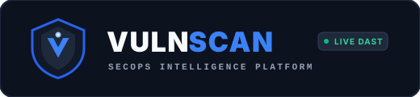

<br/>
<br/>


**Automated Web Vulnerability Assessment, AI/ML Posture Intelligence & Safe DAST Engine**

[](https://python.org)
[](https://fastapi.tiangolo.com)
[](https://react.dev)
[](https://www.typescriptlang.org)
[](https://tailwindcss.com)
[](https://scikit-learn.org)
[](https://www.docker.com)
[](LICENSE)

<br/>
<br/>

### ⚡ Automated Scan Pipeline Telemetry (Live Animated Demo)


</div>

---

## 📸 Platform User Interface & Live Screenshots

### 1. 🛡️ Security Operations Dashboard & Telemetry
Real-time posture assessment, CVSS severity distribution, active scans telemetry, and attack surface metrics.
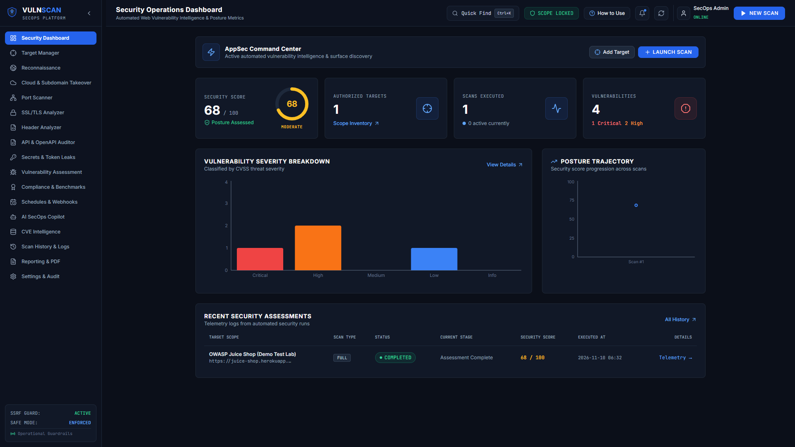

### 2. 🤖 AI SecOps Copilot & Static Code Auditor (SAST)
Interactive cybersecurity analyst, real-time code vulnerability auditor, and ML EPSS threat velocity predictor.
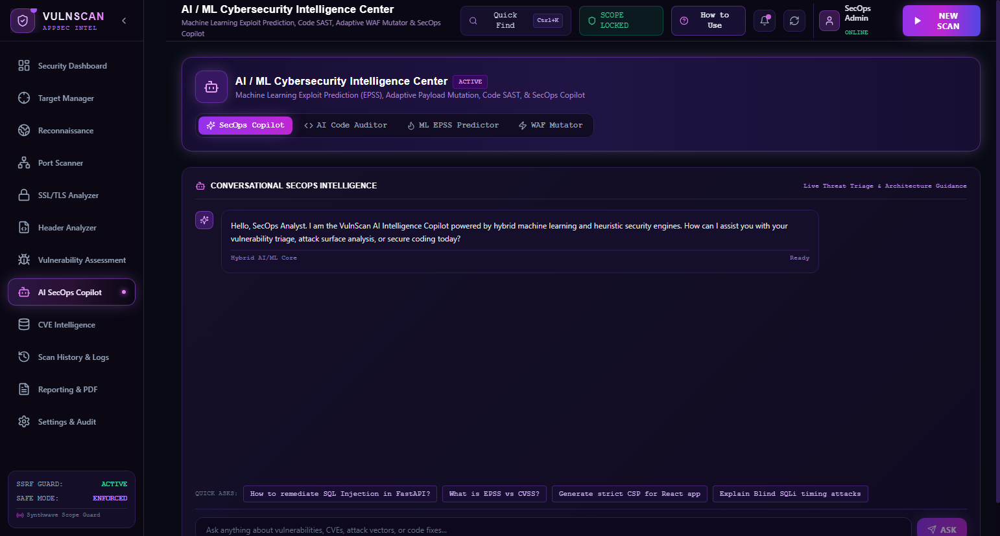

### 3. ⚡ Vulnerability Assessment & Safe DAST Engine
Detailed CWE vulnerability findings, technical canary probe evidence, and on-demand DAST testbed.
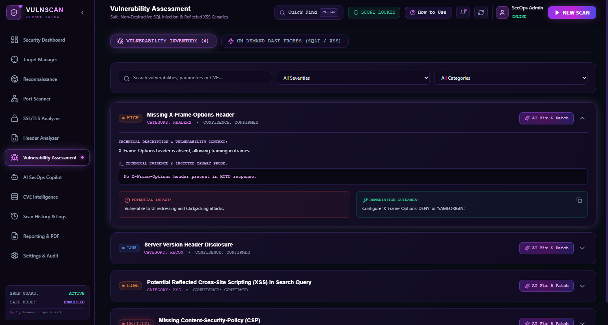

### 4. 🧠 Multi-Framework AI Remediation & Code Patch Synthesizer
Generates production-ready, copy-pasteable patches (Python, Node.js, Nginx WAF) with root-cause analysis.
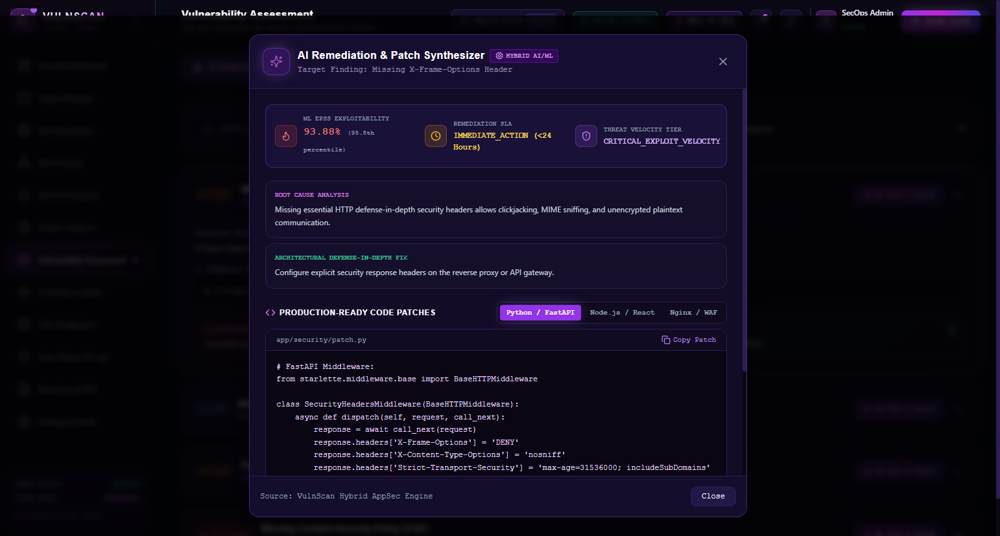

### 5. 🎯 Authorized Scope & Target Inventory
SSRF guardrails, domain ownership verification, and scope allowlisting.
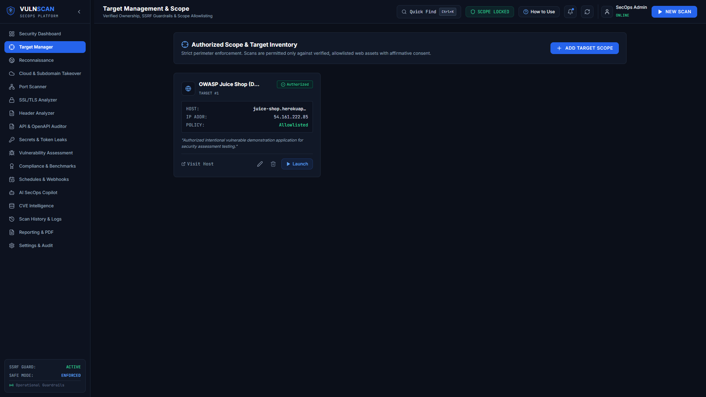

### 6. 📖 Operator Field Guide (Interactive How-To)
Built-in 5-section operational manual covering quickstart workflows, modular scanners, AI tools, and keyboard shortcuts.
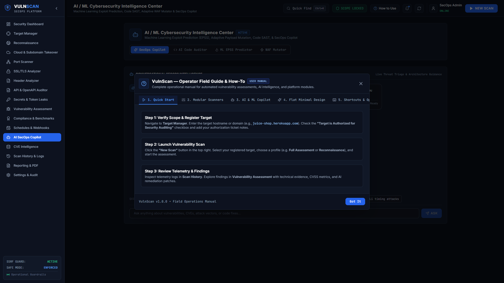

### 7. 📄 Executive & Technical PDF Reports Archive
One-click ReportLab PDF compiler for CISO briefings and compliance documentation.
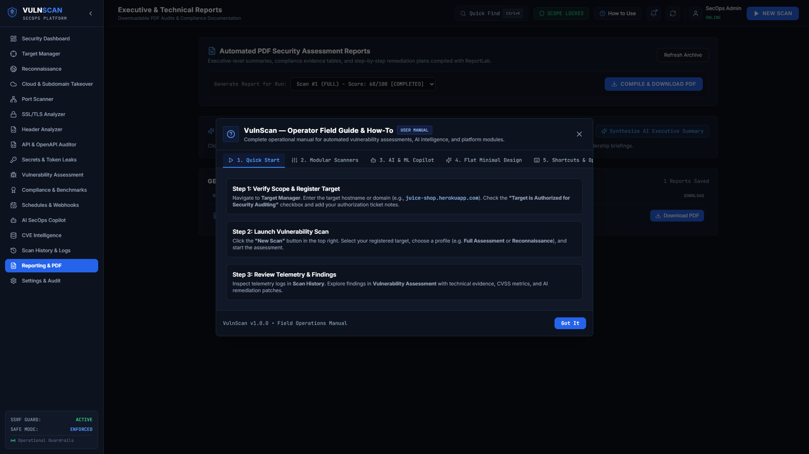

### 8. 🌐 API Security & OpenAPI / Swagger Auditor
Automated OWASP API Top 10 analysis detecting BOLA/IDOR (API1), Broken Authentication (API2), and sensitive query leaks.
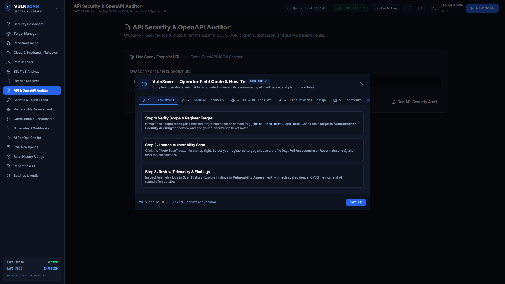

### 9. 🏛️ Regulatory Compliance Matrix & Benchmarks
Real-time control cross-mapping against SOC 2 Type II, ISO/IEC 27001:2022, PCI-DSS v4.0, and HIPAA Security Rule.
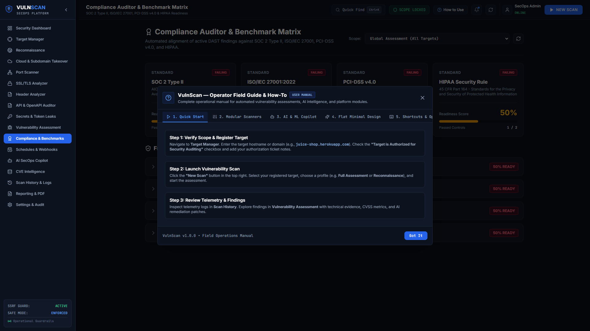

---

## 🛡️ Executive Overview & Problem Statement

Modern enterprise web applications are frequently exposed to complex attack surfaces ranging from misconfigured HTTP defense headers and cryptographically deprecated cipher suites to injection flaws and vulnerable software dependencies. Traditional vulnerability assessment tools often suffer from:

1. **Destructive Testing Risks:** Heavy scanner payloads that risk corrupting production database tables or crashing backend services.
2. **SSRF Blindspots:** Scanners running without internal IP constraints that can be weaponized into Server-Side Request Forgery pivot proxies.
3. **Abstract Vulnerability Reports:** Raw vulnerability titles with zero actionable code-level patches tailored to the developer's application stack.
4. **Disjointed Toolchains:** Running Nmap, SSLScan, Nikto, and custom scripts independently without central telemetry or audit logging.

**VulnScan** addresses these challenges by consolidating multi-stage reconnaissance, non-destructive DAST verification, machine-learning exploitability modeling (EPSS), static code analysis (SAST), and automated PDF reporting into a secure, single-pane-of-glass SecOps command center.

---

## 🛠️ Complete Technology Stack

### 🎨 Frontend Architecture
| Technology | Category | Official Badge & Logo | Purpose |
| :--- | :--- | :--- | :--- |
| **React** | Core Framework | [](https://react.dev) | High-performance SPA command-center dashboard |
| **TypeScript** | Language | [](https://www.typescriptlang.org) | Strict type contracts and interface guarantees |
| **Vite** | Build Tool | [](https://vitejs.dev) | Instantaneous HMR and optimized production bundling |
| **Tailwind CSS** | Styling System | [](https://tailwindcss.com) | Professional flat dark design (zero neon glow, solid matte surfaces) |
| **Framer Motion** | Motion Engine | [](https://www.framer.com/motion) | Smooth UI transitions and modal animations |
| **Recharts** | Data Visualization | [](https://recharts.org) | Posture trajectories and severity distribution charts |
| **Lucide Icons** | Iconography | [](https://lucide.dev) | Modern cybersecurity icon library |

#### ✨ Motion Design & Flat Micro-Animations
The user interface follows a modern **Flat Dark** design system paired with hardware-accelerated micro-animations powered by **Framer Motion**:
- **Gliding Navigation Pill (`layoutId`):** The active navigation indicator in the sidebar glides seamlessly between sections without jarring jumps.
- **Cubic-Bezier Page Transitions:** Tab switches feature sub-second transitions with soft blur filtering (`blur(2px) ➔ blur(0px)`) and cubic-bezier easing (`[0.16, 1, 0.3, 1]`).
- **Cascaded Staggered Entrances:** Telemetry overview cards, target grids, and findings lists stagger into view progressively.
- **Physics-Based Spring Modals:** The Launch Scan dialog, Command Palette (`Ctrl+K`), and AI Remediation modals animate via spring dynamics (`damping: 25, stiffness: 320`) over frosted dark backdrops.
- **Smooth Finding Accordions:** Finding descriptions, technical canary evidence, and remediation code blocks smoothly expand and collapse.
- **Tactile Button Feedback:** Tactile down-scaling (`active:scale-[0.98]`) and shimmering gradient pulse during asynchronous network queries.

### ⚙️ Backend & Asynchronous Engine
| Technology | Category | Official Badge & Logo | Purpose |
| :--- | :--- | :--- | :--- |
| **Python** | Runtime | [](https://www.python.org) | Asynchronous security audit orchestration |
| **FastAPI** | REST API | [](https://fastapi.tiangolo.com) | Asynchronous non-blocking web server and endpoints |
| **Pydantic** | Data Validation | [](https://docs.pydantic.dev) | Strict schema validation and serialization |
| **SQLAlchemy** | ORM Layer | [](https://www.sqlalchemy.org) | Database abstraction, relations, and audit persistence |
| **ReportLab** | Document Engine | [](https://www.reportlab.com) | CISO-grade technical and executive PDF report generator |
| **HTTPX & dnspython** | Network Engine | [](https://www.python-httpx.org) | Async network probing, DNS resolving & cloud bucket enumeration |
| **BeautifulSoup4** | HTML Parser | [](https://beautiful-soup-4.readthedocs.io) | Client DOM crawler & script bundle asset extraction |

### 🧠 AI & Machine Learning Intelligence Core
| Technology | Category | Official Badge & Logo | Capability |
| :--- | :--- | :--- | :--- |
| **scikit-learn** | Machine Learning | [](https://scikit-learn.org) | EPSS exploitability regression & threat modeling |
| **NumPy** | Numerical Engine | [](https://numpy.org) | Vectorized mathematical probability scoring |
| **Google Gemini API** | Large Language Model | [](https://ai.google.dev) | Multi-turn SecOps Copilot & deep architectural analysis |
| **Adaptive WAF Mutator** | Heuristic Security | [](#) | Filter evasion synthesis for DAST testing |

### 🔔 SecOps Integrations & Webhooks
| Integration | Category | Official Badge & Logo | Purpose |
| :--- | :--- | :--- | :--- |
| **Discord Webhooks** | Alerting | [](https://discord.com) | Real-time formatted rich embed cards with score indicators |
| **Slack Webhooks** | Incident Management | [](https://slack.com) | Structured Block Kit incident cards for SecOps channels |
| **Generic SIEM** | Log Ingestion | [](#) | Standardized JSON telemetry for Splunk, Datadog & ELK |

---

## ⚡ Comprehensive Module Breakdown

### 1. Security Operations Command Dashboard
- **Security Score Calculation:** Computes a composite health score (0–100) factoring in CVSS weights:
  $$\text{Score} = \max(0, 100 - [25 \times N_{\text{crit}} + 15 \times N_{\text{high}} + 7 \times N_{\text{med}} + 2 \times N_{\text{low}}])$$
- **Telemetry Distribution:** Visualizes real-time distribution across Critical, High, Medium, and Low vulnerabilities.
- **Historical Posture Trajectory:** Area chart tracking resilience improvements over time.

### 2. Target Scope & SSRF Guardrail Management
- **Explicit Scope Allowlisting:** Enforces manual verification of domain ownership prior to probe initiation.
- **SSRF Protective Filter:** Resolves domain DNS and inspects destination IPs against private, loopback, and cloud metadata ranges (`10.0.0.0/8`, `172.16.0.0/12`, `192.168.0.0/16`, `127.0.0.0/8`, `169.254.169.254`). Rejects any internal pivoting attempts.

### 3. DNS Reconnaissance & Fingerprinting Engine
- **DNS Telemetry:** Resolves and validates `A`, `AAAA`, `MX`, `NS`, `TXT`, `CNAME`, and `SOA` records.
- **Subdomain Discovery:** Asynchronously enumerates subdomains (`api`, `dev`, `staging`, `admin`, `vpn`, `mail`, `auth`, `portal`) using non-intrusive DNS queries.
- **Stack Fingerprinting:** Identifies web servers (Nginx, Apache, Cloudflare, Caddy), frameworks (Express, React, Django), and cookie parameters (`HttpOnly`, `SameSite`, `Secure`).

### 4. Controlled TCP Port Scanner
- Non-destructive TCP connect handshakes on common service ports (`21`, `22`, `25`, `53`, `80`, `110`, `143`, `443`, `465`, `587`, `993`, `995`, `3000`, `3306`, `5432`, `6379`, `8000`, `8080`, `8443`).
- Service banner grabbing to identify running daemon versions.

### 5. SSL / TLS Security Analyzer
- **Certificate Chain Audit:** Validates Common Name (CN), Subject Alternative Names (SANs), Issuer authority, and expiration countdown.
- **Protocol Verification:** Tests TLS 1.2 and TLS 1.3 handshakes while flagging insecure legacy protocols (SSLv3, TLS 1.0, TLS 1.1).
- **Cipher Suite Evaluation:** Detects deprecated CBC, RC4, 3DES ciphers and validates Perfect Forward Secrecy (PFS) support.
- **Security Grade Assignment:** Rates configuration from `A+` down to `F`.

### 6. HTTP Defense-in-Depth Header Analyzer
- Audits modern defensive response headers:
  - `Content-Security-Policy` (CSP)
  - `Strict-Transport-Security` (HSTS)
  - `X-Frame-Options` (Clickjacking prevention)
  - `X-Content-Type-Options` (MIME-sniffing prevention)
  - `Referrer-Policy` & `Permissions-Policy`
- Flags information leakage headers (`Server`, `X-Powered-By`, `X-AspNet-Version`).

### 7. Safe Non-Destructive DAST Prober
- **Safe SQLi Verification:** Employs single-quote syntax boundary balancing (`'`, `''`, `"`) to identify unhandled SQL error signatures (MySQL, PostgreSQL, MSSQL, Oracle, SQLite) without modifying rows or injecting payload logic.
- **Canary Reflected XSS Probing:** Injects harmless, unique UUID canary tokens (`vulnscan_<uuid><test_xss>`) to detect reflected DOM contexts without executing malicious JavaScript.

### 8. CVE Intelligence Hub
- Automatically cross-references fingerprinted software banners (e.g., `Apache/2.4.49`, `OpenSSL/1.0.2`, `PHP/7.4.3`) against an indexed CVE database with official CVSS scores and Mitre/NVD references.

### 9. API Security & OpenAPI / Swagger Auditor
- Static and runtime audit of OpenAPI 3.0+ and Swagger 2.0 specifications against the OWASP API Security Top 10:
  - **API1:2023 Broken Object Level Authorization (BOLA / IDOR):** Identifies endpoint parameters containing object identifiers (`{user_id}`, `{id}`, `{account}`) lacking explicit authentication scopes.
  - **API2:2023 Broken Authentication:** Detects administrative or mutative routes accessible without OAuth2/Bearer or API key scopes.
  - **API4:2023 Unrestricted Resource Consumption:** Flags collection listing endpoints missing pagination parameters (`limit`, `offset`, `page`).
  - **Sensitive Query Leaks:** Flags query parameters passing authentication credentials (`api_key`, `token`, `secret`) in cleartext URLs.

### 10. Subdomain Takeover & Cloud Bucket Leak Scanner
- **Dangling CNAME Verification:** Probes active DNS canonical name records for abandoned third-party SaaS hosting pointers susceptible to subdomain takeover:
  - GitHub Pages (`github.io`)
  - AWS S3 Buckets (`s3.amazonaws.com`)
  - Heroku (`herokuapp.com`)
  - Shopify (`myshopify.com`)
  - Surge.sh (`surge.sh`)
  - Fastly CDN (`fastly.net`)
- **Public Cloud Storage Scanner:** Evaluates bucket name permutations against AWS S3 and Google Cloud Storage (GCS) to detect unauthenticated XML object listings.

### 11. Regulatory Compliance Auditor & Benchmark Matrix
- Continuously cross-maps active vulnerability findings and missing defensive controls against 4 premier compliance frameworks:
  - **SOC 2 Type II:** AICPA Trust Services Criteria CC6.1 (Logical Access), CC6.6 (Boundary Protection), CC6.8 (Vulnerability Remediation), CC7.1 (Transmission Cryptography).
  - **ISO/IEC 27001:2022:** Controls A.8.8 (Technical Vulnerability Management), A.8.20 (Network Security), A.8.24 (Use of Cryptography).
  - **PCI-DSS v4.0:** Requirements 6.4.1 (Web Application Firewalls & Injection Defense), 4.1.2 (Strong Cryptography & TLS), 11.3.1 (External Penetration Testing).
  - **HIPAA Security Rule:** 45 CFR § 164.312(a)(1) (Access Control), § 164.312(e)(1) (Transmission Security).
- Computes readiness percentages, passed/total control metrics, and lists specific violating findings.

### 12. Client-Side Secrets & Leaked API Key Detector
- Deep-crawls target web pages and client JavaScript bundles to identify hardcoded credentials before adversaries find them:
  - OpenAI & Anthropic Secret Keys (`sk-[a-zA-Z0-9]{20,50}`)
  - AWS IAM Access Key IDs (`AKIA...`)
  - Stripe Live Secret Keys (`sk_live_...`)
  - GitHub Personal Access Tokens (`ghp_...`)
  - Google Cloud / Firebase API Keys (`AIza...`)
  - Slack Bot / User Tokens (`xox[baprs]-...`)
  - Private RSA / PGP Cryptographic Keys
- Automatically masks sensitive token values and provides immediate key-revocation checklists.

### 13. Scheduled Automated Scans & Webhook Alerts
- Configurable background recurring scanning (Hourly, Daily, Weekly) across all authorized targets.
- **Enterprise Webhook Integrations:**
  - **Discord:** Color-coded rich embed cards with security score gauges, critical threat counts, and action advisories.
  - **Slack:** Structured Block Kit messages formatted for security team incident triage channels.
  - **Custom SIEM:** Standardized JSON event payloads for Splunk, Elastic SIEM, and Datadog ingestion.
- Built-in one-click "Test Ping" delivery verification.

---

## 🧠 AI & Machine Learning Architecture

```
┌────────────────────────────────────────────────────────────────────────┐
│                   VULNSCAN AI/ML INTELLIGENCE ENGINE                   │
├────────────────────────────┬───────────────────────────────────────────┤
│ 1. ML EPSS Threat Scoring  │ Calibrated logistic regression model      │
│                            │ calculating in-the-wild exploit velocity  │
├────────────────────────────┼───────────────────────────────────────────┤
│ 2. AI Code SAST Auditor    │ Static source code analyzer detecting     │
│                            │ CWE-89, CWE-78, CWE-798, CWE-79 flaws     │
├────────────────────────────┼───────────────────────────────────────────┤
│ 3. Multi-Framework Fixes   │ Production patches for FastAPI, Node.js,  │
│                            │ Django, and Nginx configurations          │
├────────────────────────────┼───────────────────────────────────────────┤
│ 4. Adaptive WAF Mutator    │ Heuristic filter-bypass payload synthesis │
│ 5. Hybrid Fallback Core    │ 100% offline Scikit-Learn local core +    │
│                            │ optional Google Gemini 2.5 Flash SDK      │
└────────────────────────────┴───────────────────────────────────────────┘
```

### Mathematical EPSS Model
The Exploit Prediction Scoring System (EPSS) estimates the empirical probability $P(\text{Exploit})$ that a vulnerability will be actively exploited in the wild within 30 days:

$$z = w_0 + w_1 \cdot \text{CVSS}_{\text{norm}} + w_2 \cdot C_{\text{category}} + w_3 \cdot V_{\text{remote}} + w_4 \cdot E_{\text{PoC}} + w_5 \cdot A_{\text{auth}}$$

$$P(\text{Exploit}) = \frac{1}{1 + e^{-z}}$$

Where:
- $\text{CVSS}_{\text{norm}} \in [0.0, 1.0]$: Normalized base severity score.
- $C_{\text{category}}$: Empirical category risk multiplier (e.g., $1.60$ for RCE, $1.35$ for SQLi, $1.15$ for XSS).
- $E_{\text{PoC}}$: Weight scalar for weaponized publicly accessible exploits.
- $V_{\text{remote}}, A_{\text{auth}}$: Attack surface ingress and credential requirement factors.

---

## 🎯 OWASP Top 10 Coverage Matrix

| OWASP Top 10 Category | VulnScan Detection Capability | Primary Module |
| :--- | :--- | :--- |
| **A01:2021 — Broken Access Control** | SSRF protection, administrative surface exposure, path traversal checking | Target Manager & Recon Engine |
| **A02:2021 — Cryptographic Failures** | Weak TLS ciphers, expired/self-signed certs, missing HSTS, plaintext protocols | SSL/TLS Analyzer & Header Engine |
| **A03:2021 — Injection** | Safe SQL injection boundary detection, OS command injection SAST, reflected XSS | DAST Prober & AI Code Auditor |
| **A05:2021 — Security Misconfiguration** | Missing CSP/X-Frame-Options headers, exposed server banners, default open ports | Header Analyzer & Port Scanner |
| **A06:2021 — Vulnerable & Outdated Components** | Fingerprint correlation with known CVE databases & EPSS threat velocity | CVE Intelligence Hub & AI Engine |

### 🛡️ OWASP API Security Top 10 (2023) Coverage Matrix

| OWASP API Category | Vulnerability Mechanism & Detection | Primary Module |
| :--- | :--- | :--- |
| **API1:2023 — Broken Object Level Authorization (BOLA / IDOR)** | Static parameter inspection detecting `{id}`, `{user_id}`, `{account}` in resource paths without verified authentication scope | API Security Auditor |
| **API2:2023 — Broken Authentication** | Detection of sensitive endpoints accessible without Bearer, OAuth2, or API key parameters | API Security Auditor |
| **API4:2023 — Unrestricted Resource Consumption** | Listing operations lacking pagination constraints (`limit`, `offset`, `page_size`) | API Security Auditor |
| **API7:2023 — Server-Side Request Forgery (SSRF)** | Enforced private IP CIDR blacklisting (`127.0.0.0/8`, `10.0.0.0/8`, `192.168.0.0/16`, AWS metadata `169.254.169.254`) | Target Manager & Network Guard |
| **Sensitive Data Exposure in URI** | Cleartext credential inspection flagging `api_key`, `secret`, `token` passed in query parameters | API Security Auditor |

---

## 📡 REST API Reference

| Method | Endpoint | Description |
| :--- | :--- | :--- |
| `GET` | `/api/v1/health` | Health check, engine version, and Safe Mode status |
| `GET` | `/api/v1/dashboard/stats` | Aggregated security posture metrics and score trajectory |
| `GET` | `/api/v1/targets` | List all authorized registered target scopes |
| `POST` | `/api/v1/targets` | Add target domain with SSRF validation and ownership check |
| `GET` | `/api/v1/scans` | List scan execution history and telemetry logs |
| `POST` | `/api/v1/scans` | Trigger asynchronous assessment pipeline (`FULL`, `RECON`, `PORT`, `VULN`) |
| `GET` | `/api/v1/findings` | Retrieve discovered vulnerabilities with filter by severity & category |
| `POST` | `/api/v1/recon/inspect` | On-demand DNS and technology fingerprint scan |
| `POST` | `/api/v1/ports/scan` | On-demand concurrent TCP port scan |
| `POST` | `/api/v1/ssl/analyze` | On-demand X.509 certificate and TLS handshake inspection |
| `POST` | `/api/v1/headers/analyze` | On-demand HTTP security header audit |
| `POST` | `/api/v1/vulnerabilities/test-sqli` | Non-destructive safe SQL injection canary test |
| `POST` | `/api/v1/vulnerabilities/test-xss` | Non-destructive reflected XSS canary probe |
| `POST` | `/api/v1/cve/check-banner` | Correlate software version string against CVE database |
| `POST` | `/api/v1/api-security/audit` | Audit live OpenAPI spec or raw JSON for BOLA/IDOR and auth bypass |
| `POST` | `/api/v1/cloud-recon/scan` | Check dangling CNAME takeovers and public S3/GCP cloud buckets |
| `GET` | `/api/v1/compliance/matrix` | Evaluate findings against SOC 2, ISO 27001, PCI-DSS, and HIPAA |
| `POST` | `/api/v1/compliance/audit` | Run targeted compliance readiness audit |
| `POST` | `/api/v1/secrets/scan` | Crawl target HTML/JS assets for exposed API keys and tokens |
| `GET` | `/api/v1/schedules` | List configured automated recurring scan schedules |
| `POST` | `/api/v1/schedules` | Register new recurring scan schedule with webhook alert dispatch |
| `POST` | `/api/v1/schedules/{id}/toggle` | Toggle schedule active/paused state |
| `DELETE` | `/api/v1/schedules/{id}` | Remove recurring scan schedule |
| `POST` | `/api/v1/schedules/test-webhook` | Dispatch immediate test webhook alert to Discord/Slack/SIEM |
| `POST` | `/api/v1/ai/remediate` | Synthesize multi-language code patch & ML EPSS prediction |
| `POST` | `/api/v1/ai/audit-code` | SAST code scanner detecting vulnerabilities in source snippets |
| `POST` | `/api/v1/ai/copilot-chat` | Interactive AI SecOps analyst query endpoint |
| `POST` | `/api/v1/ai/executive-summary` | Synthesize CISO-grade threat assessment narrative |
| `GET` | `/api/v1/reports/generate/{scan_id}` | Compile and download executive PDF report |
| `POST` | `/api/v1/heartbeat` | Client heartbeat watchdog for automated background lifecycle |
| `POST` | `/api/v1/shutdown` | Gracefully terminate server and free network sockets |

---

## 📂 Project Architecture & Directory Layout

```
VulnScan/
├── .gitignore                     # Git tracking exclusions (node_modules, pycache, dbs)
├── README.md                      # Comprehensive technical documentation & screenshots
├── docker-compose.yml             # Multi-container orchestration definition
├── launcher.py                    # Process manager: launches backend/frontend with NO_WINDOW
├── start_server.bat               # One-click silent Windows launcher
├── stop_server.bat                # Clean process terminator (frees ports 8000 & 3000)
├── docs/
│   └── screenshots/               # High-resolution real UI screenshots
├── backend/
│   ├── Dockerfile                 # Backend containerization spec
│   ├── requirements.txt           # Python dependency manifest (FastAPI, Scikit-Learn, etc.)
│   ├── app/
│   │   ├── config.py              # Central engine configuration & environment settings
│   │   ├── database.py            # SQLAlchemy database engine & session factory
│   │   ├── main.py                # FastAPI application entrypoint & watchdog handlers
│   │   ├── api/                   # Modular REST API endpoints
│   │   │   ├── ai.py              # AI Copilot, EPSS predictor, SAST auditor
│   │   │   ├── api_security.py    # OpenAPI / Swagger BOLA/IDOR auditor
│   │   │   ├── cloud_recon.py     # Subdomain takeover & S3/GCP bucket scanner
│   │   │   ├── compliance.py      # SOC 2, ISO 27001, PCI-DSS & HIPAA matrix
│   │   │   ├── cve.py             # CVE intelligence hub
│   │   │   ├── dashboard.py       # Posture metrics & score telemetry
│   │   │   ├── findings.py        # Vulnerability inventory & filters
│   │   │   ├── headers.py         # HTTP security header analyzer
│   │   │   ├── ports.py           # Controlled TCP port scanner
│   │   │   ├── recon.py           # DNS reconnaissance & stack fingerprinting
│   │   │   ├── reports.py         # PDF compilation & download router
│   │   │   ├── scans.py           # Pipeline orchestrator & cancel router
│   │   │   ├── schedules.py       # Automated scan scheduler & webhook router
│   │   │   ├── secrets.py         # Client-side secrets & API key scanner
│   │   │   ├── settings.py        # Engine guardrails & audit trails
│   │   │   ├── ssl.py             # TLS handshake & cipher inspector
│   │   │   ├── targets.py         # Scope management & SSRF validation
│   │   │   └── vulnerabilities.py # Safe DAST SQLi/XSS live testbed
│   │   ├── models/                # Database models (Target, Scan, Finding, Schedule, AuditLog)
│   │   ├── schemas/               # Pydantic request/response schemas
│   │   └── services/              # Core security auditing services & AI engine
│   │       ├── ai_engine.py       # Scikit-Learn EPSS model & Gemini fallback
│   │       ├── api_security_service.py # OpenAPI AST parser & BOLA auditor
│   │       ├── cloud_recon_service.py  # CNAME dangling verification & bucket enumerator
│   │       ├── compliance_service.py   # Regulatory control matrix evaluation
│   │       ├── secret_scanner_service.py # JavaScript bundle token extractor
│   │       └── webhook_service.py      # Discord embed & Slack Block Kit dispatcher
│   └── tests/                     # Automated pytest test suites (14 tests, 100% pass rate)
└── frontend/
    ├── Dockerfile                 # Frontend containerization spec
    ├── package.json               # Node.js dependencies & scripts
    ├── tailwind.config.js         # Theme styling & flat design palette configuration
    ├── vite.config.ts             # Vite bundler & reverse proxy configuration
    └── src/
        ├── App.tsx                # Master UI layout & watchdog beacon
        ├── index.css              # Professional flat dark styling (matte surfaces, zero neon glow)
        ├── api/                   # Typed API client with complete backend coverage
        ├── components/            # Reusable UI widgets, badges, dials & modals
        └── pages/                 # Full dashboard workspaces:
            ├── Dashboard.tsx      # Posture analytics & real-time telemetry
            ├── Targets.tsx        # Scope management & SSRF verification
            ├── Reconnaissance.tsx # DNS & technology fingerprinting
            ├── CloudRecon.tsx     # Subdomain takeover & bucket detection
            ├── PortScanner.tsx    # Controlled TCP port discovery
            ├── SslAnalyzer.tsx    # TLS cipher & X.509 cert analysis
            ├── HeaderAnalyzer.tsx # HTTP security header policy grading
            ├── ApiSecurity.tsx    # OpenAPI / Swagger BOLA/IDOR auditor
            ├── SecretScanner.tsx  # Client bundle secret & token leaker
            ├── VulnerabilityAssessment.tsx # Safe DAST SQLi & XSS probers
            ├── ComplianceMatrix.tsx # SOC2, ISO27001, PCI-DSS & HIPAA
            ├── Schedules.tsx      # Background scheduler & webhooks
            ├── AiCopilot.tsx      # Interactive analyst, EPSS & SAST
            ├── CveIntelligence.tsx# Software banner CVE database
            ├── ScanHistory.tsx    # Execution logs & timeline
            ├── Reports.tsx        # Executive PDF archive
            └── Settings.tsx       # System config & audit logs
```

---

## 🚀 Quick Start & Installation

### Prerequisites
- **Python 3.10+** (Python 3.11 or 3.14 recommended)
- **Node.js 18+** & **npm**

### Option 1: One-Click Silent Launch (Windows)
Double-click `start_server.bat` in the project root:
```cmd
start_server.bat
```
- **Zero Open CMD Windows:** Launches backend and frontend silently in the background with `CREATE_NO_WINDOW`.
- **Auto-Shutdown on Browser Close:** Closing your browser window triggers an automated heartbeat watchdog (`navigator.sendBeacon('/api/v1/shutdown')`) that cleanly frees ports `8000` and `3000`.
- *(Manual stop: Double-click `stop_server.bat` anytime)*

### Option 2: Live Development Launch with Terminal Logs
Double-click `run_dev.bat` in the project root:
```cmd
run_dev.bat
```
- Launches both FastAPI backend and Vite frontend in dedicated terminal windows displaying live HTTP requests, scan logs, and HMR events.

### Option 3: Manual Terminal Execution

#### 1. Backend Service
```bash
cd backend
python -m pip install -r requirements.txt
python -m uvicorn app.main:app --host 127.0.0.1 --port 8000 --reload
```
- API Base: `http://127.0.0.1:8000`
- Swagger Interactive Docs: `http://127.0.0.1:8000/api/docs`

#### 2. Frontend Application
```bash
cd frontend
npm install
npm run dev
```
- Web Application: `http://localhost:3000`

---

## 🧪 Testing & Verification

### Run Backend Unit Tests
VulnScan includes an automated test suite verifying scanner guardrails, SSRF validation, advanced OpenAPI / BOLA logic, compliance matrices, and AI/ML algorithms:
```bash
cd backend
python -m pytest tests/
```
```text
backend\tests\test_advanced_features.py ......   [ 42%]
backend\tests\test_ai_engine.py .....            [ 78%]
backend\tests\test_scanner.py ...                [100%]
======================= 14 passed in 3.30s =======================
```

### Run Frontend Production Build
```bash
cd frontend
npm run build
```
```text
✓ 2556 modules transformed.
dist/index.html                   1.18 kB │ gzip:   0.68 kB
dist/assets/index-BBE68GYr.css   51.02 kB │ gzip:   9.02 kB
dist/assets/index-CnRr5k7r.js   891.33 kB │ gzip: 240.61 kB
✓ built in 17.37s
```

---

## ⚖️ Legal & Ethical Use Disclaimer

> **IMPORTANT:** VulnScan is engineered strictly for authorized security auditing, defensive hardening, vulnerability remediation, and educational assessment of systems where the operator has explicit, documented authorization from the asset owner. Running security scans against third-party systems without prior written consent violates federal and international cybersecurity laws (including the US Computer Fraud and Abuse Act 18 U.S.C. § 1030). The developers assume no liability for misuse or damage resulting from the operation of this software.

---

## 📄 License

This project is licensed under the [MIT License](LICENSE).
